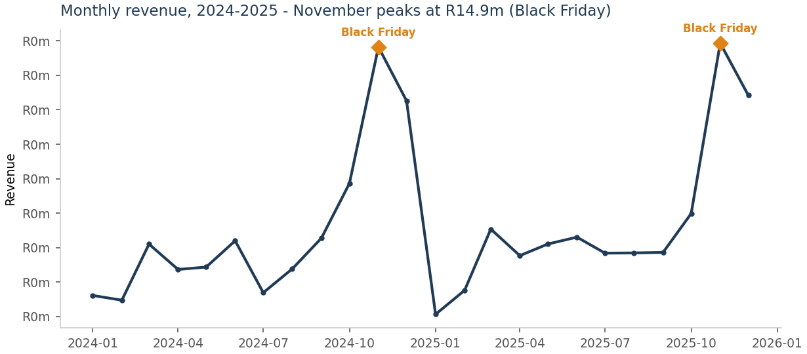
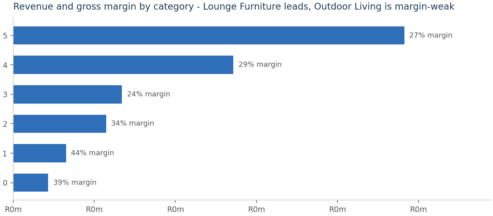
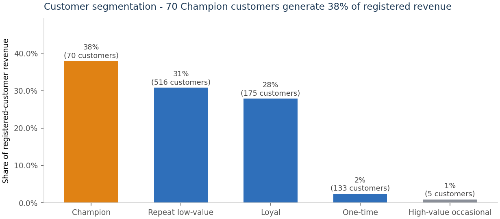

# Retail Sales Analytics - SQL + Star Schema + Interactive Dashboard

End-to-end sales performance analysis for a fictional South African home-ware
retailer (**Mzansi Home & Living**, simulated data): a raw ERP-style extract is
modelled into a validated **star schema** in SQLite, six business questions are
answered in **SQL**, and the results are published as an **interactive Plotly
dashboard** and a consulting-style solution summary.



## Why this project exists

Retail businesses rarely lack data - they lack **answers they can act on**. The
brief: *"revenue growth has stalled; find out where margin is being lost."*
This project walks the full path a data analyst / SAP analytics consultant
would walk: understand the question → shape the data → answer with evidence →
recommend.

## What's inside

| Piece | Description |
| --- | --- |
| `src/01_generate_data.py` | Generates a simulated ERP-style sales extract (43,465 billing lines, 2024-2025, fixed seed for reproducibility) |
| `src/02_build_star_schema.py` | Builds DIM_Date / DIM_Store / DIM_Product / DIM_Customer + FACT_Sales, loads SQLite, runs validation (FK checks + revenue reconciliation to the cent) |
| `src/03_analyse_sql.py` | Six business questions answered in SQL; results saved as CSV |
| `src/04_dashboard.py` | Builds the interactive dashboard and static previews |
| `output/sales_dashboard.html` | **Open in your browser** - KPI header + 9 linked views |
| `docs/01_business_requirements.md` | Consulting-style requirements document (stakeholders, questions, scope, success criteria) |
| `docs/02_data_model.md` | Star schema design decisions + full data dictionary |
| `docs/03_solution_summary.md` | Findings and recommendations, quantified in Rand |



## Headline findings

- **Growth is flat: +1.7% YoY** (R 114.5m → R 116.4m gross). The business is
  structurally dependent on Black Friday (November ≈ 50% above an average
  month); base months show no organic growth.
- **Promotions erode margin**: promo lines (10.2% of revenue) earn **18.0%**
  margin vs **30.3%** on non-promo lines - and growth is flat, so the
  incremental value is questionable.
- **Returns are concentrated in furniture**: Lounge + Bedroom + Outdoor =
  86% of the R 8.5m returned value; Outdoor Living has the worst return rate
  (5.6% of units).
- **Margin engine is underweight**: Decor & Lighting earns 44.0% margin but is
  only 5.7% of revenue.
- **Customer concentration**: 70 Champion customers = 38% of registered
  revenue; 60% of sales are anonymous walk-ins that no CRM action can reach.

Full evidence chain in `docs/03_solution_summary.md`.



## How to run

```bash
pip install -r requirements.txt
python src/01_generate_data.py      # ~1 min, fixed seed -> data/raw/
python src/02_build_star_schema.py  # builds + validates SQLite warehouse
python src/03_analyse_sql.py        # answers Q1-Q6, writes analysis CSVs
python src/04_dashboard.py          # writes output/sales_dashboard.html + charts
```

Then open `output/sales_dashboard.html` in a browser (internet needed for the
Plotly.js CDN). Every number in the docs and dashboard is regenerated from
scratch by these four commands.

## Skills demonstrated

- **Data modelling**: star schema, conformed dimensions, additive measures,
  credit-note style returns, fact/dimension grain decisions
- **SQL**: CTEs, conditional aggregation, RFM segmentation, data validation
  and reconciliation queries (SQLite; the SQL is standard and portable)
- **Analysis**: seasonality, margin-mix and promo-effectiveness analysis,
  return-rate economics, RFM customer segmentation
- **Communication**: requirements doc → data dictionary → quantified
  findings → recommendations, i.e. the deliverable chain of a consulting
  engagement
- **Visualisation**: interactive Plotly dashboard with KPI header, plus
  publication-style static charts


